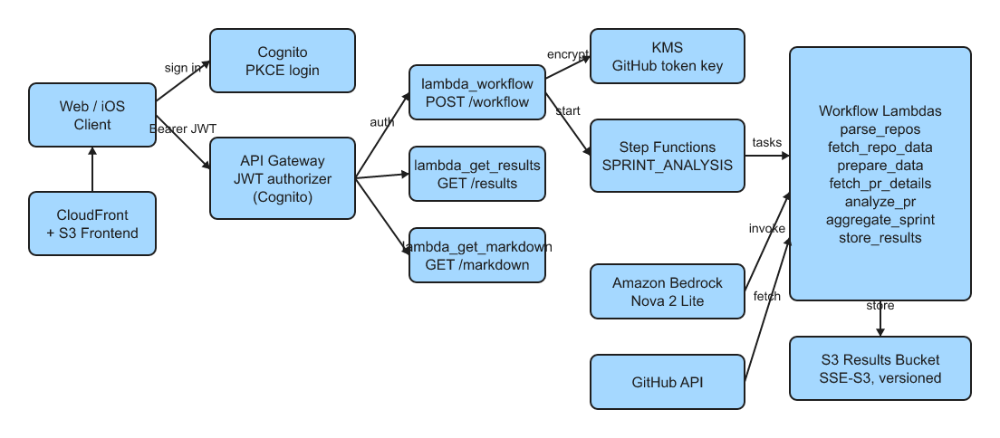
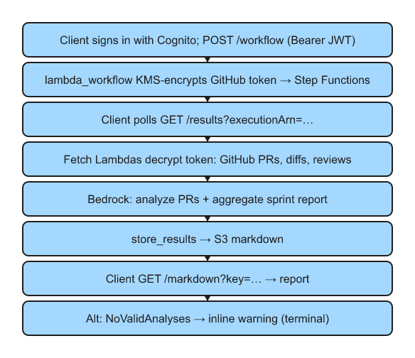

# Sprint Intelligence

An agentic AI system that analyzes GitHub sprint activity and generates executive-quality reports: deterministic orchestration in Step Functions, with Amazon Nova on Bedrock analyzing each PR and writing the sprint summary.





## Services

| Component | Role |
|---|---|
| Cognito user pool (managed login, PKCE) | Open sign-up through Google and Sign in with Apple; no password accounts |
| API Gateway HTTP API + JWT authorizer | Every route requires a Cognito access token (`authorization_type = "JWT"`, enforced by a `terraform check`) |
| `lambda_workflow` | Validates the request, KMS-encrypts the GitHub token, starts Step Functions |
| `lambda_delete_account` | `DELETE /account`: deletes the caller's Cognito user (App Store guideline 5.1.1(v)); exposed in web and iOS Settings |
| Step Functions workflow | Parse repos → fetch PRs → fetch PR details → analyze PRs → aggregate → store; `NoPRsFound` / `NoValidAnalyses` terminal paths |
| `analyze_pr`, `aggregate_sprint` | Bedrock Converse API with Amazon Nova 2 Lite (`us.amazon.nova-2-lite-v1:0` by default, `var.bedrock_model_id`); IAM allows only the configured model |
| `fetch_repo_data`, `fetch_pr_details` | Only Lambdas allowed to decrypt the GitHub token |
| KMS key (`alias/<env>_github_token`) | Per-execution encryption context; only ciphertext appears in execution history and logs |
| S3 results bucket | Per-user prefixes `users/<cognito-email>/…` for reports and workflow JSON; SSE-S3, versioned, objects expire after 3 days |
| React app (`static_site/`) | Vite + Vitest, `react-oidc-context`; light/dark/system themes, vector PDF export (jsPDF), App Store badge and Safari Smart App Banner (`src/config/appStore.js`); routes `/`, `/features`, `/run` prerendered with per-page meta, JSON-LD, `sitemap.xml`, and `robots.txt` (`src/config/seo.js`); served by CloudFront + S3 (OAC), with a CloudFront Function mapping `/path` to `/path/index.html` |
| iOS app (`mobile/Arc Agent/`) | SwiftUI, iOS 27.2, iPhone tab bar and iPad sidebar; `WebAuthenticationSession` PKCE sign-in, tokens and GitHub PAT in the Keychain; CoreText PDF export |

### Security

- **No shared client secrets.** Clients hold only the public Cognito app client ID; each user signs in with Google or Apple and calls the API with a 1-hour access token.
- **GitHub token never stored in plaintext server-side.** The web app keeps it in `sessionStorage` (per tab), the iOS app in the Keychain. Both clients bind the token to the signed-in Cognito subject and clear it on sign-out or account change. `lambda_workflow` encrypts it with KMS (context: `purpose`, `executionName`) before `StartExecution`; ciphertext from one execution cannot be decrypted under another.
- **Report markdown is treated as untrusted.** Web and iOS renderers allowlist link schemes (`http`, `https`, `mailto`, and same-page `#` on web) and strip raw HTML; model output never uses `rehype-raw` or equivalent.
- **Self-service deletion.** Users delete their own account from Settings; the Lambda deletes only the user named in the caller's token.
- **Per-user report isolation.** `lambda_workflow` sets `ownerId` from the JWT `username` (email). All workflow artifacts live under `users/<email>/` in the results bucket. `GET /results` and `GET /markdown` reject keys and executions that belong to another user.
- CORS restricted to `https://<env>.<domain>`; the shared logger redacts `githubToken`, `authorization`, `token`, `secret`, `password`.

## Prerequisites

| Tool | Version |
|---|---|
| AWS CLI | ≥ 2 |
| Node.js | 24.x |
| Terraform | ≥ 1.10.5 |
| Xcode | ≥ 27.2, with the iOS 27.2 simulator runtime |
| Google Cloud project | For Google sign-in |
| Apple Developer Program membership | For Sign in with Apple and the iOS app |

## Setup

### 1. Infrastructure

```bash
cd terraform
cp terraform.tfvars.example terraform.tfvars
terraform init
terraform plan -out=plan.out
terraform apply plan.out
```

| Output | Use |
|---|---|
| `api_url` | `API_URL` repo variable |
| `cognito_authority` | `COGNITO_AUTHORITY` repo variable |
| `cognito_client_id` | `COGNITO_CLIENT_ID` repo variable, `Secrets.cognitoClientId` |
| `cognito_domain` | `COGNITO_DOMAIN` repo variable, `Secrets.cognitoDomain` |
| `cognito_idp_response_url` | Redirect URI for Google and Apple (step 2) |
| `github_actions_role_arn` | `AWS_ROLE_ARN` repo variable |
| `cloudfront_distribution_id` | `CLOUDFRONT_DISTRIBUTION_ID` repo variable |
| `site_bucket_name` | `SITE_BUCKET` repo variable |

Until step 2 is done, the Cognito app client offers no social providers and nobody can sign up.

### 2. Google and Apple sign-in

Both providers redirect back to Cognito, not to the app. You need two values from Terraform:

```bash
terraform -chdir=terraform output -raw cognito_domain
```

```bash
terraform -chdir=terraform output -raw cognito_idp_response_url
```

#### Google

1. In [Google Cloud Console](https://console.cloud.google.com/), select or create a project.
2. **Google Auth Platform → Branding**: set the app name, support email, and the authorized domain (`<domain>`, e.g. `brewsentry.com`).
3. **Google Auth Platform → Audience**: choose **External**, then **Publish app** so any Google account can sign in.
4. **Google Auth Platform → Data access**: add the `openid`, `email`, and `profile` scopes.
5. **Google Auth Platform → Clients → Create client**:
   - Application type: **Web application**
   - Authorized JavaScript origins: the `cognito_domain` value (`https://auth.<env>.<domain>`)
   - Authorized redirect URIs: the `cognito_idp_response_url` value (`https://auth.<env>.<domain>/oauth2/idpresponse`)
6. Copy the **Client ID** and **Client secret**.

#### Apple

In [Certificates, Identifiers & Profiles](https://developer.apple.com/account/resources/identifiers/list):

1. **Identifiers → App IDs**: open (or register) the iOS app's App ID (`com.bernsonfamily.com.Arc-Agent`) and enable **Sign in with Apple**.
2. **Identifiers → Services IDs → +**: register a Services ID, e.g. `com.bernsonfamily.arcagent.signin`. This identifier is `APPLE_SERVICES_ID`.
3. Open the Services ID, enable **Sign in with Apple**, click **Configure**:
   - Primary App ID: the App ID from step 1
   - Domains and Subdomains: `auth.<env>.<domain>` (no scheme)
   - Return URLs: the `cognito_idp_response_url` value
4. **Keys → +**: name the key, enable **Sign in with Apple**, configure it with the same primary App ID, register, and **download the `.p8` file** (Apple only lets you download it once). Note the **Key ID**.
5. Your **Team ID** is shown under **Membership details** (top right of the developer portal).

#### Store the credentials and apply

```bash
gh variable set GOOGLE_CLIENT_ID  --body "<google client id>"
gh variable set APPLE_SERVICES_ID --body "<apple services id>"
gh variable set APPLE_TEAM_ID     --body "<apple team id>"
gh variable set APPLE_KEY_ID      --body "<apple key id>"
```

```bash
gh secret set GOOGLE_CLIENT_SECRET
```

```bash
gh secret set APPLE_PRIVATE_KEY < AuthKey_XXXXXXXXXX.p8
```

```bash
gh workflow run terraform.yml
```

Terraform creates the `Google` and `SignInWithApple` identity providers and switches the app client to them; the managed login page then shows both buttons.

### 3. Local config

```bash
cp static_site/.env.example static_site/.env.local
cp "mobile/Arc Agent/Arc Agent/Secrets.swift.example" "mobile/Arc Agent/Arc Agent/Secrets.swift"
```

Local web development needs `auth_dev_callback_urls = ["http://localhost:5173/"]` in `terraform.tfvars`.

### 4. Build and run

```bash
cd static_site && npm install && npm run dev
```

```bash
cd static_site && SITE_URL=https://<env>.<domain> npm run build
```

```bash
cd architecture/scripts && npm install && npm run export
```

## Design system

[`design/tokens.json`](design/tokens.json) defines color (light and dark), type, spacing, radius, elevation, and motion. It generates `static_site/src/styles/tokens.css`, `static_site/src/styles/palette.js` (PDF), and `mobile/Arc Agent/Arc Agent/Theme/DesignTokens.swift`; `npm test` in `static_site` fails if they drift or a declared contrast pair drops below WCAG AA. Figma: [Arc Agent — Design System & Screens](https://www.figma.com/design/M14FX6HZHVd5d4tL6PHRrZ).

```bash
node design/build-tokens.mjs
```

## Testing

```bash
cd backend/shared && npm install && npm test
```

```bash
for dir in backend/*/; do [ "$dir" = "backend/shared/" ] && continue; (cd "$dir" && npm install && npm test -- --passWithNoTests); done
```

```bash
cd static_site && npm test
```

```bash
xcodebuild test -project "mobile/Arc Agent/Arc Agent.xcodeproj" -scheme "Arc Agent" -destination "platform=iOS Simulator,name=iPhone 17 Pro,OS=27.2"
```

```bash
cd terraform && terraform fmt -check -recursive && terraform validate
```

## CI/CD

Path-filtered GitHub Actions workflows; each also supports `workflow_dispatch`. `mobile/` is not built in CI. Dependabot ([`.github/dependabot.yml`](.github/dependabot.yml)) opens grouped weekly updates for npm, Terraform, and Actions.

| Workflow | Triggers on | PR | Push to `main` |
|---|---|---|---|
| `backend.yml` | `backend/**` | build shared → test changed Lambdas | test → `aws lambda update-function-code` |
| `frontend.yml` | `static_site/**` | test + build | test + build + S3 sync + CloudFront invalidation |
| `terraform.yml` | `terraform/**` | plan (PR comment, text only) | plan + apply in one job (`production` environment; plan file stays on runner, not uploaded) |

### Repository variables

```bash
cd terraform
gh variable set AWS_REGION                 --body "us-east-1"
gh variable set TF_DOMAIN                  --body "example.com"
gh variable set TF_ENVIRONMENT             --body "agentic_ai_demo"
gh variable set AWS_ROLE_ARN               --body "$(terraform output -raw github_actions_role_arn)"
gh variable set CLOUDFRONT_DISTRIBUTION_ID --body "$(terraform output -raw cloudfront_distribution_id)"
gh variable set SITE_BUCKET                --body "$(terraform output -raw site_bucket_name)"
gh variable set API_URL                    --body "$(terraform output -raw api_url)"
gh variable set COGNITO_AUTHORITY          --body "$(terraform output -raw cognito_authority)"
gh variable set COGNITO_CLIENT_ID          --body "$(terraform output -raw cognito_client_id)"
gh variable set COGNITO_DOMAIN             --body "$(terraform output -raw cognito_domain)"
```

Secrets: `GOOGLE_CLIENT_SECRET`, `APPLE_PRIVATE_KEY` (step 2). AWS access uses GitHub OIDC.

## Monitoring

- CloudWatch alarm on Step Functions `ExecutionsFailed` ([`terraform/cloudwatch_alarms.tf`](terraform/cloudwatch_alarms.tf)); no SNS action is attached yet
- Lambda logs retained 30 days; Step Functions and API Gateway access logs 7 days

For repository structure, Lambda inventory, the authorization audit, and agent conventions, see [AGENTS.md](AGENTS.md).
