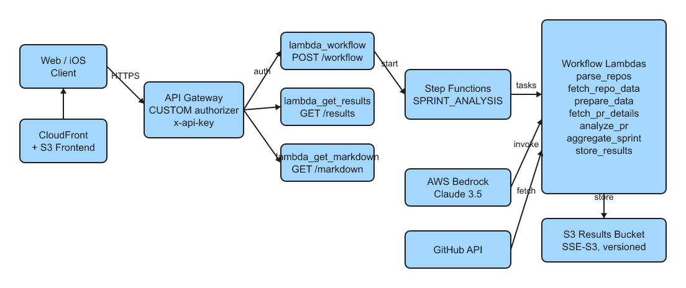
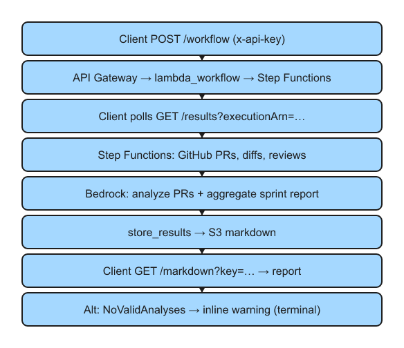

# Sprint Intelligence

A reference implementation of an agentic AI system that analyzes GitHub sprint activity and generates executive-quality reports. Designed as application-first agentic AI — roughly 70% deterministic orchestration and 30% AI reasoning.





## Project Status

This section records what is implemented, what is illustrative only, and **verification results actually observed** (not inferred from the commands below). Re-run the [Testing](#testing) commands and update the verification log when you change the codebase.

**Verification environment (2026-10-26):** macOS; Node v26.12.0; npm 11.20.0; Terraform v1.16.6; Xcode 27.1. CI targets Node 24.x per [`.github/workflows/backend.yml`](.github/workflows/backend.yml).

### Implementation status

| Component | Status | Notes |
|---|---|---|
| API Gateway + custom Lambda authorizer (`x-api-key`) | Implemented | `authorization_type = "CUSTOM"` on all routes; `terraform check` in [`terraform/apigw.tf`](terraform/apigw.tf) |
| `lambda_authorizer` | Implemented | Unit tests present; see verification log |
| `lambda_workflow` (`POST /workflow`, alias `POST /sprint-intelligence`) | Implemented | Unit tests present |
| `lambda_get_results`, `lambda_get_markdown` | Implemented | Unit tests present |
| `lambda_parse_repos`, `lambda_store_results`, `lambda_aggregate_sprint` | Implemented | Unit tests present |
| `lambda_analyze_pr`, `lambda_fetch_pr_details`, `lambda_fetch_repo_data`, `lambda_prepare_data` | Implemented | Unit tests added; see verification log |
| CloudWatch alarm (Step Functions `ExecutionsFailed`) | Implemented (config only) | [`terraform/cloudwatch_alarms.tf`](terraform/cloudwatch_alarms.tf) |
| Step Functions workflow (`NoPRsFound`, `NoValidAnalyses` terminal paths) | Implemented | Defined in [`terraform/step_functions.tf`](terraform/step_functions.tf); not exercised in local tests |
| `@sprint/shared` | Implemented | Unit tested in isolation |
| React frontend (`static_site/`) | Implemented | Unit tests + production build verified locally |
| iOS app (`mobile/Arc Agent/`) | Implemented | XCTest targets exist; not run locally on 2026-10-26 (simulator unavailable) |
| GitHub Actions (frontend, backend, terraform) | Implemented (workflows only) | Not executed against this branch in the verification pass |
| Terraform infrastructure | Implemented (config only) | `terraform validate` passed locally; no successful `plan`/`apply` in this pass |

### Illustrative components

These items support understanding or onboarding; they are not live infrastructure diagrams or production data.

| Item | Role |
|---|---|
| [`architecture/exports/*.png`](architecture/exports/) / [`.svg`](architecture/exports/) | Simplified diagrams generated from [`architecture/scripts/diagram-helpers.cjs`](architecture/scripts/diagram-helpers.cjs). Omits IAM, logging, and full Step Functions detail. |
| [`static_site/src/components/OverviewPage.js`](static_site/src/components/OverviewPage.js), [`FeaturesPage.js`](static_site/src/components/FeaturesPage.js) | Marketing / explanatory copy |
| [`terraform/terraform.tfvars.example`](terraform/terraform.tfvars.example), [`static_site/.env.example`](static_site/.env.example), [`Secrets.swift.example`](mobile/Arc%20Agent/Arc%20Agent/Secrets.swift.example) | Placeholder configuration only |
| `POST /sprint-intelligence` | Alias route to the same handler as `POST /workflow` |

### Verification log

| Date | Area | Command | Result |
|---|---|---|---|
| 2026-10-26 | `@sprint/shared` | `cd backend/shared && npm test` | **Pass** — 4 suites, 18 tests |
| 2026-10-26 | All Lambdas (except shared) | `npm test -- --passWithNoTests` per package | **Pass** — 11 suites, 34 tests total |
| 2026-10-26 | `lambda_get_results` | `npm install` (adds `@aws-sdk/client-sfn` devDep) + `npm test` | **Pass** — 1 suite, 4 tests |
| 2026-10-26 | React frontend | `cd static_site && npm test -- --watchAll=false --ci` | **Pass** — 5 suites, 40 tests |
| 2026-10-26 | React frontend | `npm run build` | **Pass** — production build completed |
| 2026-10-26 | Architecture export | `cd architecture/scripts && npm run export` | **Pass** — regenerated PNG/SVG for architecture and workflow |
| 2026-10-26 | Terraform | `terraform fmt -check -recursive` | **Pass** |
| 2026-10-26 | Terraform | `terraform init -backend=false` + `terraform validate` (with `TF_VAR_environment`, `TF_VAR_domain`, `TF_VAR_region`) | **Pass** — configuration valid (includes `cloudwatch_alarms.tf`, `use_lockfile = true`, 30-day log retention) |
| 2026-10-26 | Terraform | `terraform plan` (S3 backend) | **Not run** — S3 state object returned 403 (no access to `bsc.sandbox.terraform.state` from local credentials) |
| 2026-10-26 | iOS | `xcodebuild test` (README destination) | **Not run** — no matching iOS Simulator (`CoreSimulator` out of date; iPhone 17 simulator not available) |

### Not verified in this pass

- `terraform plan` or `terraform apply` against AWS with readable remote state
- End-to-end workflow (GitHub API → Step Functions → Bedrock → S3 → report download)
- GitHub Actions runs for current workflow pins (Node 24, `nodejs24.x`, upgraded action majors, `TF_VAR_*` wiring)
- Load, penetration, or accessibility testing
- Live Bedrock or GitHub calls (unit tests use mocks)

### Known limitations

- **Shared API key auth:** The API uses a single `x-api-key` validated by the custom authorizer. The key is embedded in the React bundle via `REACT_APP_API_KEY` ([`static_site/src/utils/api.js`](static_site/src/utils/api.js)) and in the iOS app via gitignored `Secrets.swift`. There is no Cognito or per-user identity.
- **GitHub token handling:** Users store a GitHub token in browser `localStorage` ([`static_site/src/config/settings.js`](static_site/src/config/settings.js)). The token is sent in the workflow request body and propagated through Step Functions as `githubToken` ([`terraform/step_functions.tf`](terraform/step_functions.tf)), so it may appear in execution history.
- **Bedrock model:** Default model ID is `us.anthropic.claude-3-5-sonnet-20241022-v2:0` ([`terraform/variables.tf`](terraform/variables.tf)). Availability and lifecycle in your AWS account/region must be confirmed before production use.
- **Terraform state locking:** S3 backend uses native lockfile locking (`use_lockfile = true` in [`terraform/backend.tf`](terraform/backend.tf)). Confirm your Terraform version and IAM permissions support lockfiles before concurrent applies.
- **Frontend toolchain:** `react-scripts` 5.0.1 is unmaintained. After `npm install` in `static_site/`, `npm audit` reported **57** vulnerabilities (9 low, 29 moderate, 18 high, 1 critical) on 2026-10-26.
- **Logging retention:** Lambda CloudWatch log retention is **30** days ([`terraform/local.tf`](terraform/local.tf)).
- **Monitoring:** A Step Functions failure alarm is defined in Terraform; no SNS/email subscription or dashboard is wired yet.

### Remaining production requirements

- Per-user authentication (e.g. Cognito + JWT authorizer) instead of a shared API key in client apps
- Remove GitHub PAT from Step Functions input; use Secrets Manager, OIDC, or a GitHub App
- Integration or E2E tests against a non-production AWS stack
- Run and review `terraform plan` before apply (local plan still blocked without S3 state access)
- Migrate off Create React App; remediate `npm audit` findings
- Confirm Bedrock model ID and quotas in target region
- Run and pass all GitHub Actions workflows on a PR before merge
- Wire CloudWatch alarm actions (SNS/PagerDuty) and operational dashboards

For repository structure, Lambda inventory, authorization audit, and agent conventions, see [AGENTS.md](AGENTS.md).

## Prerequisites

| Tool | Version |
|---|---|
| AWS CLI | ≥ 2 |
| Node.js | 24.x |
| Terraform | ≥ 1.10.5 |
| Xcode | ≥ 15 |

## Secrets Setup

**Never commit real secrets.** All sensitive values live in exactly one of:

- `mobile/Arc Agent/Arc Agent/Secrets.swift` — iOS constants (gitignored)
- `static_site/.env.local` — React environment overrides (gitignored)
- `terraform/*.tfvars` — Terraform variables (gitignored)

Copy the example files before local development:

```bash
cp terraform/terraform.tfvars.example terraform/terraform.tfvars
cp static_site/.env.example static_site/.env.local
cp "mobile/Arc Agent/Arc Agent/Secrets.swift.example" \
   "mobile/Arc Agent/Arc Agent/Secrets.swift"
```

Retrieve the generated API key after `terraform apply`:

```bash
aws secretsmanager get-secret-value \
  --secret-id "$(terraform -chdir=terraform output -raw api_key_secret_name)" \
  --query SecretString --output text | jq -r .API_KEY
```

## Infrastructure

```bash
cd terraform
cp terraform.tfvars.example terraform.tfvars
terraform init
terraform plan -out=plan.out
terraform apply plan.out
```

Outputs after apply:

| Output | Description |
|---|---|
| `api_key_secret_name` | Secrets Manager secret containing `API_KEY` |
| `api_url` | API Gateway base URL (`https://api.<domain>`) |
| `frontend_url` | CloudFront frontend URL (`https://<env>.<domain>`) |
| `results_bucket` | S3 bucket name for sprint reports |

## Frontend

```bash
cd static_site
cp .env.example .env.local
npm install
npm start
npm run build
```

## Architecture Diagrams

Excalidraw sources live under `architecture/diagrams/`. Regenerate PNG and SVG exports:

```bash
cd architecture/scripts
npm install
npm run export
```

## Testing

Commands below are for local reproduction only. **Observed pass/fail results with dates** belong in [Project Status → Verification log](#verification-log); update that table after you run them.

```bash
cd backend/shared && npm install && npm test

for dir in backend/*/; do
  [[ "$dir" == "backend/shared/" ]] && continue
  echo "=== $dir ===" && (cd "$dir" && npm test --passWithNoTests)
done

cd static_site && npm test

xcodebuild test \
  -project "mobile/Arc Agent/Arc Agent.xcodeproj" \
  -scheme "Arc Agent" \
  -destination "platform=iOS Simulator,name=iPhone 17"

cd terraform && terraform fmt -check -recursive && terraform validate
```

## Security

- Every API Gateway route uses `authorization_type = "CUSTOM"` (Lambda authorizer)
- API key is stored in Secrets Manager; rotatable without redeployment
- `x-api-key` is redacted in all Lambda logs by the shared logger
- CORS is restricted to `https://<env>.<domain>`
- S3 results bucket: SSE-S3, versioning enabled, 90-day lifecycle on old versions
- CloudFront serves the frontend via Origin Access Control (OAC)

## CI/CD

Three path-filtered GitHub Actions workflows run automatically. `mobile/` changes are ignored by CI.

| Workflow | Triggers on | PR action | Push to `main` action |
|---|---|---|---|
| `backend.yml` | `backend/**` | build shared → test changed lambdas | build shared → test → `aws lambda update-function-code` |
| `frontend.yml` | `static_site/**` | test + build | test + build + S3 sync + CloudFront invalidation |
| `terraform.yml` | `terraform/**` | plan (PR comment) | plan → apply |

The Terraform workflow does not read a committed `terraform.tfvars` file. It sources `environment`, `domain`, and `region` from GitHub Actions variables via `TF_VAR_*` environment variables (`TF_ENVIRONMENT`, `TF_DOMAIN`, `AWS_REGION`).

### Required GitHub repository variables and secrets

After the first manual `terraform apply`, populate these under **Settings → Secrets and variables → Actions**:

**Variables** (plaintext, visible in logs):

| Variable | How to get the value |
|---|---|
| `AWS_REGION` | AWS region for the deployment (e.g., `us-east-1`) |
| `AWS_ROLE_ARN` | `terraform output -raw github_actions_role_arn` |
| `CLOUDFRONT_DISTRIBUTION_ID` | `terraform output -raw cloudfront_distribution_id` |
| `REACT_APP_API_URL` | `terraform output -raw api_url` |
| `SITE_BUCKET` | `terraform output -raw site_bucket_name` |
| `TF_DOMAIN` | Base domain name (e.g., `brewsentry.com`) |
| `TF_ENVIRONMENT` | Environment name for Terraform and Lambda naming (e.g., `agentic_ai_demo`) |

**Secrets** (encrypted, never visible in logs):

| Secret | How to get the value |
|---|---|
| `REACT_APP_API_KEY` | API key from Secrets Manager (`terraform output -raw api_key_secret_name`) |

### First-time setup

```bash
cd terraform
terraform apply

gh variable set AWS_REGION                 --body "us-east-1"
gh variable set TF_DOMAIN                  --body "brewsentry.com"
gh variable set TF_ENVIRONMENT             --body "agentic_ai_demo"
gh variable set AWS_ROLE_ARN               --body "$(terraform output -raw github_actions_role_arn)"
gh variable set CLOUDFRONT_DISTRIBUTION_ID --body "$(terraform output -raw cloudfront_distribution_id)"
gh variable set REACT_APP_API_URL          --body "$(terraform output -raw api_url)"
gh variable set SITE_BUCKET                --body "$(terraform output -raw site_bucket_name)"

API_KEY=$(aws secretsmanager get-secret-value \
  --secret-id "$(terraform output -raw api_key_secret_name)" \
  --query SecretString --output text | jq -r .API_KEY)
gh secret set REACT_APP_API_KEY --body "$API_KEY"
```

### Frontend deploy details

The S3 sync uses split cache-control headers:

- Hashed assets (`static/js/*.js`, `static/css/*.css`) → `max-age=31536000,immutable`
- Entry points (`index.html`, `asset-manifest.json`) → `max-age=0,must-revalidate`

A CloudFront invalidation on `/*` follows every deploy.

## Contributing

1. Follow the coding conventions in `.cursor/rules/`
2. Add unit tests for any new Lambda handler logic
3. Run `terraform fmt` before committing Terraform changes
4. Keep [AGENTS.md](AGENTS.md) current when adding routes or changing auth behavior
